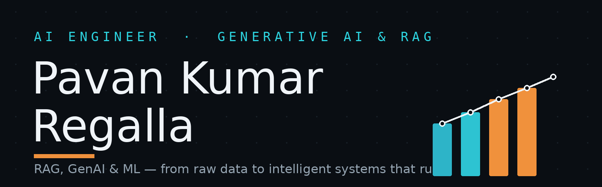

I'm Pavan. I'm an AI Engineer, and I like building things that actually run — RAG systems that answer from real documents with citations, ML models that catch fraud in a live stream, and the data pipelines underneath that don't break at 2am.

These days I work on generative AI and retrieval (RAG, embeddings, vector search, LangChain, Amazon Bedrock, Azure OpenAI) and ML (anomaly detection, forecasting) — standing on batch + streaming data engineering (Spark, Kafka, Delta Lake, Databricks), mostly on AWS. Microsoft Azure AI Engineer Associate (AI-102) and AWS Certified Data Engineer – Associate.

### Stack

### Work you can run

| Project | What it does |
|---|---|
| [Cloud Analytics Knowledge Search](https://github.com/pavanregalla1/cloud-analytics-knowledge-search) | RAG knowledge search over 300 synthetic enterprise documents — dense embeddings (MiniLM) + TF-IDF hybrid retrieval, recall@1 87.5%, extractive answers with citations, Streamlit UI |
| [Real-Time Retail Intelligence](https://github.com/pavanregalla1/realtime-retail-intelligence) | Kafka → Spark Structured Streaming → Delta Lake platform with ML anomaly detection and forecasting, real-time fraud alerts, dbt-tested |
| [Retail Sales Analytics](https://github.com/pavanregalla1/retail-sales-analytics) | Batch lakehouse (bronze/silver/gold) processing 56K+ orders ($80.96M), 10/10 data-quality checks, PySpark/Databricks port |
| [Portfolio](https://pavanregalla.dev) | Personal portfolio website — AI Engineer |

### Certifications

- Microsoft Azure AI Engineer Associate (AI-102)
- AWS Certified Data Engineer – Associate
- Microsoft Power BI Data Analyst Associate (PL-300)
- Databricks Certified Data Analyst Associate
- Databricks Fundamentals Accreditation

### Stats

### Find me

